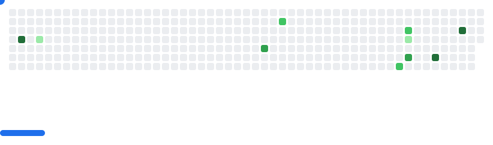

[](https://git.io/typing-svg)

<br />
<br />
<br />

<div align="center"> 

---

<!-- README-STATS:START -->

```
🕰️ I get my jam on during the night!

🌞 Morning  	359    commits	███████░░░░░░░░░░░░░░░░░░░░░░░	9.59%
🌆 Daytime  	1291   commits	████████████████████████████░░	34.48%
🌃 Evening  	724    commits	███████████████░░░░░░░░░░░░░░░	19.34%
🌙 Night    	1370   commits	██████████████████████████████	36.59%
```

```
📅 I'm most productive on Wednesdays!

Monday      	464    commits	████████████████████░░░░░░░░░░	12.39%
Tuesday     	595    commits	██████████████████████████░░░░	15.89%
Wednesday   	685    commits	██████████████████████████████	18.30%
Thursday    	546    commits	███████████████████████░░░░░░░	14.58%
Friday      	538    commits	███████████████████████░░░░░░░	14.37%
Saturday    	484    commits	█████████████████████░░░░░░░░░	12.93%
Sunday      	432    commits	██████████████████░░░░░░░░░░░░	11.54%
```

```
🧪 JavaScript for the win!

JavaScript  	77     repos	██████████████████████████████	21.15%
CSS         	61     repos	███████████████████████░░░░░░░	16.76%
TypeScript  	61     repos	███████████████████████░░░░░░░	16.76%
HTML        	53     repos	████████████████████░░░░░░░░░░	14.56%
Shell       	22     repos	████████░░░░░░░░░░░░░░░░░░░░░░	6.04%
```

<!-- README-STATS:END -->

---

### **Principais Tecnologias**
[](https://skillicons.dev)

### **Tecnologias que também utilizo**

#### **Back-End**
[](https://skillicons.dev)

#### **Front-End**
[](https://skillicons.dev)

#### **Outras Tecnologias**
[](https://skillicons.dev)

---

<br />
<br />
<br />
<br />
<br />

<picture>
  <source media="(prefers-color-scheme: dark)" srcset="https://raw.githubusercontent.com/GuiCardilho/GuiCardilho/output/github-snake-dark.svg" />
  <source media="(prefers-color-scheme: light)" srcset="https://raw.githubusercontent.com/GuiCardilho/GuiCardilho/output/github-snake.svg" />
  
</picture>

<picture>
  <source
    media="(prefers-color-scheme: dark)"
    srcset="images/breakout-dark.svg"
  />
  <source
    media="(prefers-color-scheme: light)"
    srcset="images/breakout-light.svg"
  />
  
</picture>
 

